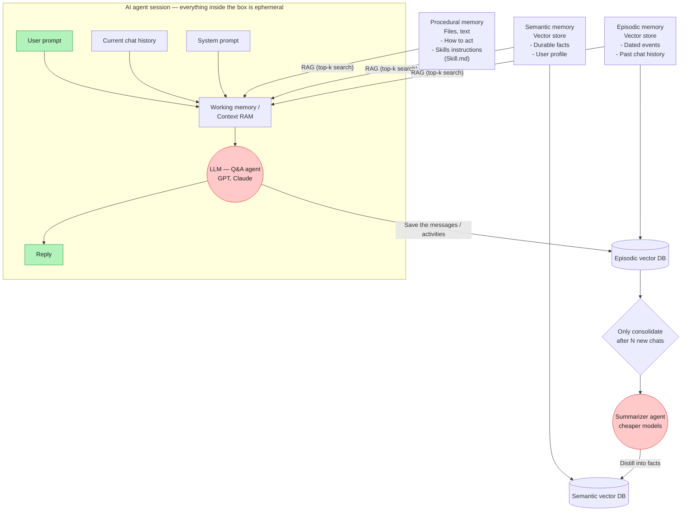

# AI agent memory system: semantic, episodic & procedural memory + RAG

## Architecture

**How it works:**
- Everything inside the session box (user prompt, chat history, system prompt) is ephemeral — it exists only for that turn.
- Working memory pulls relevant context from three long-term stores via RAG top-k search: **procedural** (how to act — skills/instructions, e.g. `Skill.md`), **semantic** (durable facts, user profile), and **episodic** (dated events, past chat history).
- Every reply's raw messages/activity get saved into the episodic vector DB.
- Once N new chats accumulate, a cheaper "summarizer agent" consolidates episodic events, distilling them into durable facts that get written into the semantic vector DB.

*A couple of arrow directions/labels were inferred where the source frame was partly obscured by the video controls — flag anything that should read differently.*
