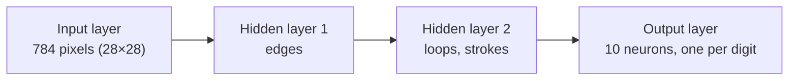

# How does a network learn to recognize a "3"?

*Neural Networks — Visual Recap*

Four ideas, in the order the playlist built them: the neuron, the network, the cost, and the two ways of moving downhill — gradient descent and backpropagation.



---

## 01 — The Neuron

### A neuron is just a number

Not a biological thing — a single value between `0` and `1`, called its **activation**. For the first layer, that number is a pixel's brightness. For every layer after, it's computed from the layer before.

```
a = σ( w₁a₁ + w₂a₂ + … + wₙaₙ + b )
```

**Weights** say how strongly each input matters — positive weights excite, negative weights inhibit. The **bias** shifts how easy the neuron is to activate at all. `σ` (originally sigmoid, later ReLU in the follow-up) squashes the raw sum into a clean range so the signal doesn't explode as it passes through layer after layer.

This is exactly the line `act.tanh()` in your own `Neuron.__call__` — a weighted sum, squashed.

---

## 02 — The Network

### Layers turn pixels into a decision

Stack neurons into layers, and layers into a network: **784** input pixels (28×28) → hidden layers that (ideally) learn to detect edges, then loops and strokes → **10** output neurons, one per digit.

> Every one of those inter-layer connections carries a weight, and every neuron carries a bias. A modest network already has **thousands** of these numbers — that's the actual thing being "learned." Training doesn't hand-craft edge detectors; it searches this huge number space for a setting where the right output neuron lights up most.

Your `MLP` class does this with a list of `Layer`s — same idea, just 2 → 4 → 4 → 1 instead of 784 → 16 → 16 → 10.

---

## 03 — The Cost Function

### Turning "wrong" into a number

Feed in an image of a "3." A brand-new, randomly-initialized network outputs garbage — ten roughly-equal activations. The **cost** measures exactly how wrong: square the difference between each output activation and what it should have been (1 for the "3" neuron, 0 for the rest), then sum.

```
C = Σ ( output₀ − desired₀ )²
```

Average that cost over thousands of training images and you get **one single number** describing how bad the network currently is. Training is nothing more than: *make that number small.*

This is your `loss = sum((yout - ygt) ** 2 ...)` line, just averaged over far more examples.

---

## 04 — Gradient Descent

### Rolling downhill in a very high-dimensional space

Picture the cost function as a landscape with thousands of dimensions — one per weight and bias. **Gradient descent** asks a purely local question at your current position: *which tiny nudge to every parameter decreases the cost fastest?* That direction is the negative gradient. Take a small step, ask again, repeat.

It never sees the whole landscape — only ever the local slope. That's why it can get stuck in an okay-but-not-perfect valley, and why the **learning rate** (step size) matters: too big and you overshoot the valley; too small and training crawls.

This is your training loop's `p.data -= learning_rate * p.grad` — one nudge, repeated 50 times.

---

## 05 — Backpropagation

### The algorithm that computes the gradient

Gradient descent tells you *what* to do with the gradient. **Backpropagation** is *how* you actually compute it — efficiently, for every single weight and bias, without brute-forcing each one separately.

> Start at the output neurons and ask: which neurons in the layer before most influenced this error, and by how much? Push that "blame" backward one layer at a time, scaling it by each connection's weight along the way — the chain rule, applied over and over. By the time you reach the input layer, every weight and bias in the network has its share of the blame.

Do this for one training example, average the "desired nudges" over a random batch (**stochastic** gradient descent), and you have one real training step.

This is, literally, your `Value.backward()` — the topological sort and the reversed walk through `_backward()` calls **is** backpropagation, at the scale of a whole computational graph instead of one neuron's weighted sum.

---

*three blue one brown, chapters 1–4 — compressed to what carried into `micrograd.py`*
